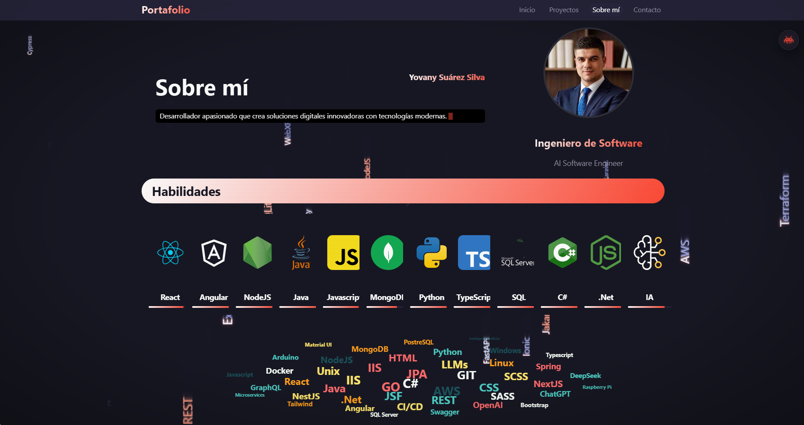

# Portfolio CDSMAIA

_Portafolio de proyectos desarrollados en CDSMAIA._

Aplicación web construida con **Angular 19** que presenta la trayectoria, los proyectos y los datos de contacto de **Yovany Suárez Silva**. Incluye rendering del lado del servidor (SSR), formulario de contacto con persistencia en MongoDB Atlas, telemetría de navegación, ranking de un mini-juego arcade y panel de analítica.

## Vista previa



========================================================================

_portafolio.cdsmaia.cloud_

## Características

* **Home**: portada animada con efecto *typewriter*, avatar y fondo de partículas.
* **Sobre mí**: presentación profesional y nube de palabras (word cloud).
* **Proyectos**: catálogo con galería de capturas (slider), etiquetas tecnológicas, proyecto destacado y filtro por tipo (clientes, propios, open source).
* **Contacto**: formulario que guarda los mensajes en MongoDB Atlas y envía un aviso por email (Resend).
* **Arcade**: mini-juego tipo bubble con ranking global persistido en MongoDB.
* **Telemetría**: medición anónima de navegación (sesiones y eventos) con respeto a *Do Not Track*.
* **Analítica**: dashboard con gráficas (Chart.js) para visualizar la telemetría acumulada.
* **SSR + hidratación**: prerendering con `@angular/ssr` y *event replay*.
* **Seguridad**: cabeceras CSP, hash de IP con sal, listas blancas de orígenes y límites anti-flooding en memoria.

## Stack tecnológico

* [NodeJS](https://nodejs.org/es/) — Entorno de ejecución de JavaScript en el servidor.
* [Angular](https://angular.io/) — Framework de desarrollo (v19, standalone components + SSR).
* [Express](https://expressjs.com/) — Servidor de la API y del sitio compilado.
* [MongoDB Atlas](https://www.mongodb.com/es/atlas) — Persistencia de contactos, ranking y telemetría.
* [Resend](https://resend.com/) — Aviso por email de cada contacto nuevo.
* [Chart.js](https://www.chartjs.org/) + [ng2-charts](https://github.com/valor-software/ng2-charts) — Gráficas del panel de analítica.
* [NPM](https://www.npmjs.com/) — Gestor de dependencias.

## Puesta en marcha 🚀

Estas instrucciones te permiten obtener una copia del proyecto funcionando en tu máquina local.

### Prerrequisitos 📋

* **Node.js** instalado y disponible en la terminal.
* **Git** instalado con una cuenta configurada para clonar el repositorio.
* **NPM** para la gestión de paquetes y arranque de la aplicación.

### Instalación 🔧

```
git clone https://github.com/desobsesor/portfolio-web.git
```

Luego, en la raíz del proyecto, instala las dependencias:

```
npm i
```

### Configuración de entorno

Copia `.env.example` a `.env` y completa las variables según el entorno:

* `MONGODB_URI` y `MONGODB_DB` — cadena y base de datos de MongoDB Atlas. Sin la URI el sitio funciona, pero el formulario de contacto responde `503`.
* `RESEND_API_KEY` y `CONTACT_AVISO_PARA` — envío del aviso por email por cada contacto nuevo (opcional).
* `CONTACT_ORIGENES`, `ARCADE_ORIGENES` y `TELEMETRIA_ORIGENES` — listas blancas de orígenes; vacías = solo se acepta el tráfico del propio dominio.
* `*_SAL` y `*_CONFIA_PROXY` — sal del hash de IP y flag para operar detrás de un proxy que informe `x-forwarded-for`.
* Interruptor de telemetría en el navegador: campo `telemetria` de `src/environments/environment*.ts` (`'1'` fuerza, `'0'` apaga, `''` mide solo en producción).

### API (endpoints)

La API se monta en Express y se sirve desde dos puntos de entrada: `src/server.ts` (SSR con `@angular/ssr`) y `src/api-server.ts` (API + sitio estático, sin SSR). Al cargar el código fuente, manéjalo así:

| Método | Ruta | Descripción |
| ------ | ---- | ----------- |
| `GET`  | `/api/contact` | Health check del endpoint de contacto. |
| `POST` | `/api/contact` | Guarda un mensaje en `portfolio_contactos` y dispara el aviso por email (best-effort). |
| `GET`  | `/api/arcade/ranking` | Mejores puntajes del arcade (`limite`, máx. 25). |
| `POST`| `/api/arcade` | Registra una partida en `arcade_puntajes` con validación anti-fraude. |
| `GET`  | `/api/telemetria` | Health check de la telemetría. |
| `POST`| `/api/telemetria` | Recibe un lote de navegación y lo almacena en `telemetria_sesiones` y `telemetria_eventos` (siempre responde `204`). |

### Desarrollo

La aplicación Angular (puerto 4200) redirige `/api` al servidor Express mediante el proxy de `proxy.conf.json`:

```bash
# 1. Compila y levanta el servidor de API (puerto 4000)
npm run build:api
npm run serve:api

# 2. En otra terminal, levanta el front (http://localhost:4200)
npm run start
```

## Compilación y despliegue 📦

Para generar la versión compilada:

```
npm run build
```

Esto genera el sitio estático en `docs/` (baseHref `/portfolio-web/`). El proceso de producción en Node:

```
npm run build:api
npm run serve:api
```

`serve:api` lee `PORT` (por defecto 4000), `SITIO_ESTATICO` (por defecto `docs`) y `SITIO_BASE` (por defecto `/portfolio-web`). El mismo proceso atiende `/api/*` y sirve el HTML compilado.

> Despliegue en IIS (Windows, alternativa): activa los servicios web de IIS, instala *RewriteUrl* para permitir el acceso a los endpoints, crea un sitio que apunte a la carpeta de recursos compilados y arráncalo.

## Ejecución de las pruebas ⚙️

Las pruebas unitarias usan **Karma + Jasmine**:

```
npm test
```

Para una verificación manual del servicio en ejecución, abre `http://localhost:4200` en el navegador.

## Contribución 🖇️

Actualmente no se aceptan contribuciones externas.

## Versionado 📌

Se usa [SemVer](http://semver.org/). Consulta todas las versiones disponibles en las [tags de este repositorio](https://github.com/tu/proyecto/tags).

## Autor ✒️

* **Yovany Suárez Silva** — *Desarrollador* — [desobsesor](https://github.com/desobsesor)

## Licencia 📄

Este proyecto está bajo la licencia **Apache 2.0** — consulta [LICENSE](LICENSE) para más detalles.

---

⌨️ con ❤️ por [desobsesor](https://github.com/desobsesor)